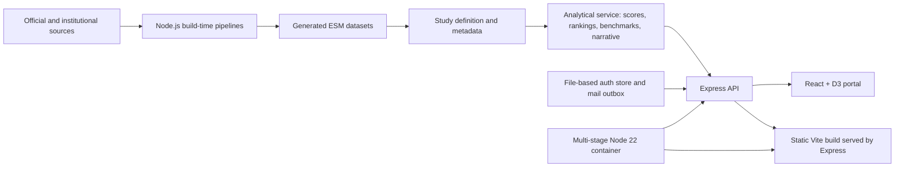

# Atlas Studio Concept Note

## Document status

This concept note describes the software and documentation present in this
repository. It is an evidence-based snapshot, not a service-level commitment,
procurement offer, or claim that every proposed extension has been implemented.

## Executive proposition

Atlas Studio is a proprietary, source-available foundation for building
access-controlled analytical microsites from heterogeneous public and
institutional data. Its current implementation is a Mexico public-security
study that combines operational pressure and public spending in a documented,
interactive state-level comparison.

The repository demonstrates a complete path from source acquisition and
normalization to a protected API, a React and D3 analytical portal, and a
single-container deployment. Its principal value is not the dashboard alone:
it is the separation of source data, analytical derivation, API contracts, and
presentation so that an analysis can be inspected, explained, and extended.

Atlas Studio should currently be understood as a functional product prototype
and an early platform foundation. It is not yet a production-certified,
multi-tenant analytics service.

## Problem and opportunity

Public and institutional data often exists without being operationally useful.
Relevant sources use different territorial keys, reporting periods,
granularities, missing-value conventions, and publication formats. A visually
polished dashboard does not solve those problems if its comparisons cannot be
traced or defended.

Atlas Studio addresses the layer before visualization:

- acquiring and caching identified source files;
- reconciling geography and measurement units;
- deriving rates, shares, rankings, benchmarks, and quality flags;
- publishing stable payloads instead of passing raw source dumps to the UI;
- placing methodology, data caveats, and access controls in the same product.

The opportunity is to reuse this structure for analytical studies in which
territories or institutions must be compared and the interpretation needs to
remain auditable. The current repository proves that pattern in one vertical;
it does not yet provide a generic multi-study product.

## Vision

The platform vision is a family of focused analytical products that share a
controlled delivery model while preserving study-specific methodology. Each
study should be able to define its own sources, dimensions, scoring rules,
quality controls, narrative, and visual surfaces without coupling those choices
to authentication or deployment infrastructure.

The intended long-term distinction is:

- **platform runtime:** access control, API delivery, documentation, audit, and
  deployment;
- **study definition:** source metadata, dimensions, weights, and interpretation
  rules;
- **generated data:** reproducible outputs from identified source cuts;
- **analytical service:** benchmarks, rankings, scores, narratives, and API
  contracts;
- **presentation:** interactive views built from those contracts.

## Intended users and stakeholders

The current product is designed for controlled access rather than anonymous
mass use. Its likely users, based on implemented surfaces, are:

- analysts who need state comparisons, drill-downs, exact tables, and visible
  methodological caveats;
- public-policy, programme, or institutional teams reviewing operational and
  budget patterns;
- decision-makers and prospective partners who need a guided, inspectable study
  rather than a static presentation;
- data and research staff responsible for source updates and transformation
  rules;
- portal administrators managing access requests, account status, password
  support, and basic usage telemetry;
- engineers operating the API, mail delivery, runtime storage, and container.

The current repository does not implement separate tenant organizations,
fine-grained analyst permissions, or a public self-service data marketplace.

## Value proposition

Atlas Studio offers four concrete forms of value:

1. **Comparable evidence.** Source-specific data is transformed before it
   reaches the interface, with explicit formulas and metadata.
2. **Analytical continuity.** State selection, rankings, matrices, trends,
   budget views, tables, and narrative use the same server-derived contracts.
3. **Explainability.** Scores remain decomposable into visible dimensions and
   documented weights; spending is presented as capacity, not proof of
   causality.
4. **Reusable delivery.** The API, access flow, documentation surface, and
   container can support further studies once the current hard-coded study
   boundary is generalized.

## Current capabilities

### Analytical portal

The React application currently provides:

- an integrated state comparison across operational and investment measures;
- a dedicated investment view for exercised budget, per-capita spending,
  federal funds, technology spending, expenditure chapters, and quality notes;
- state ranking, matrix, monthly trend, composition, driver, and tabular views
  implemented with D3 and React;
- state-level drill-down with server-generated comparisons and narrative;
- methodology and repository documentation inside the portal;
- an administration surface for account lifecycle, delivery traces, recent
  activity, and aggregated route, state, and document usage.

### API and access lifecycle

The Express service currently exposes:

- a public health check and public authentication configuration;
- email-based access request and account activation;
- login, logout, password reset, and session inspection;
- viewer and administrator roles;
- protected study and state-detail endpoints;
- protected portal-view tracking and administrator endpoints.

Activation and reset email can use SMTP or sendmail. In environments without a
mail transport, the service writes messages to a local outbox for controlled
development and testing.

### Data build

Two Node.js build scripts produce checked-in JavaScript data modules for the
runtime. The national layer covers Mexico's 32 federal entities. A separate
fine-grained build supports three heterogeneous 2024 pilots:

- Queretaro: chapter and concept;
- Mexico City: budget programme and chapter;
- Oaxaca: administrative-classification security cluster.

The fine layer deliberately preserves the granularity supplied by each source
instead of presenting unlike records as a false common taxonomy.

## Current architecture



### Technology stack

- React 19 for client state and application composition;
- D3 7 for analytical visualizations;
- Vite 8 for frontend development and bundling;
- Express 5 for JSON APIs and delivery of the compiled single-page application;
- Node.js 22 in both Docker build and runtime stages;
- Nodemailer for SMTP or sendmail delivery;
- local generated modules for study data and a local JSON store for auth state.

### Runtime topology

Production mode uses one Node process. Express serves both `/api/*` and the
compiled `dist/` directory, with an SPA fallback for non-API routes. The generic
Compose file maps a configurable host port to container port `4173` and mounts
`runtime-data` as a persistent volume.

TLS termination, DNS, reverse-proxy policy, backup scheduling, and perimeter
controls are outside the repository's current generic deployment assets.

## Data and analytical methodology

### Implemented source layers

The generated modules identify these active sources and reference periods:

- SESNSP state crime incidence for 2025;
- state population projections for 2025 as denominators for crime rates;
- INEGI CNSPE 2025 budget resources, with a 2024 budget reference period;
- 2024 population projections for per-capita budget measures;
- selected state public-account documents for the three fine-grained pilots.

INEGI homicide mortality and ENVIPE are documented as future sources and are
not inputs to the current score.

### Derivations

Crime counts are converted to rates using:

```text
rate = (count / population) * 100,000
```

For each scored dimension, the service applies min-max normalization across the
included states. Dimensions for which a lower value is preferable are inverted.
The operational score is a weighted sum of normalized homicide, extortion,
robbery with violence, family violence, and small-scale drug-market rates. The
weights currently encoded in the study are 30, 22, 20, 16, and 12 percent,
respectively.

The integrated Atlas score currently combines:

- operational score: 72 percent;
- budget per capita: 16 percent;
- exercised budget: 8 percent;
- technology-spending share: 4 percent.

Monthly operational scores are recalculated against monthly bounds rather than
inherited from the annual score. National benchmarks use simple averages for
rates and scores and sums for selected population and count fields. Rankings
respect each dimension's declared direction.

### Interpretation and quality rules

- Scores are relative to the entities and source cut included in a build; they
  are not timeless or absolute measures.
- The integrated score combines different reference periods and must be read as
  a comparative analytical device, not as a causal model.
- Higher expenditure is treated as financial capacity, not evidence that
  spending caused better security outcomes or was efficient.
- SESNSP records represent reported or registered incidents, not the complete
  universe of crime.
- Missing and special source codes are parsed explicitly, and the budget layer
  exposes flags when exercised totals, chapter detail, or reconciliation are
  incomplete.
- National comparability currently stops at expenditure chapter level. The
  three finer pilots remain heterogeneous and are labelled accordingly.

## Security, privacy, and access control

### Controls implemented in the repository

- passwords are salted and hashed with Node's `scrypt` implementation;
- activation and password-reset tokens are random and stored only as SHA-256
  hashes;
- session payloads are signed with HMAC-SHA-256 and checked against an active
  user record;
- the session cookie is `HttpOnly`, `SameSite=Lax`, and becomes `Secure` when
  configured or when HTTPS is reported by the proxy;
- protected data routes require a valid session, and admin routes additionally
  enforce the `admin` role;
- tokens expire and consumed tokens are tracked;
- account, mail-delivery, login, and portal-view events are recorded in a
  bounded local audit stream;
- the repository directs vulnerability reports to GitHub's private reporting
  channel and keeps secrets outside version control.

### Current security and privacy boundary

Authentication state is stored in `runtime-data/auth-store.json`. This makes a
single-instance demo straightforward, but it is not a transactional,
multi-instance identity store. The runtime directory can contain account data,
request metadata, audit events, hashed credentials and tokens, and, in outbox
mode, full activation or reset messages. It must therefore be treated as
sensitive persistent data and included in access-control, backup, retention,
and disposal procedures.

The repository does not currently evidence rate limiting, account lockout,
multi-factor authentication, a dedicated CSRF token mechanism, centralized
security logging, encryption at rest, automated security tests, or a user-facing
data deletion workflow. Session revocation is limited by the active-user check,
the session expiry, or rotation of the store's signing secret.

The implemented access-request flow requires both acceptance of portal terms
and promotional-email consent. That coupling, as well as retention and consent
withdrawal procedures, should be reviewed against the intended jurisdiction
and operating model before broader deployment.

## Deployment and operations

The included Dockerfile uses a multi-stage Node 22 Alpine build. It installs
locked dependencies, builds the Vite client, prunes development dependencies,
and copies only runtime application assets into the final image. The included
Compose file provides a single-service local or VPS topology with persistent
runtime storage.

Operational requirements vary by task:

- normal runtime requires Node or the built container;
- rebuilding national source data requires network access and `unzip`;
- rebuilding fine-grained pilots requires `curl` and `pdftotext`;
- production email requires SMTP or sendmail configuration;
- production HTTPS and routing require an external edge or reverse proxy.

The GitHub Actions workflow currently installs dependencies and verifies the
frontend build on pushes and pull requests. The repository has no automated
unit, integration, end-to-end, data-quality, or container smoke-test suite.

## Product maturity

Atlas Studio is beyond a static mock-up: it contains generated national data,
server-side analytical derivation, multiple working portal surfaces, a complete
basic account lifecycle, API contracts, a container build, and substantial
technical and methodological documentation.

It remains an early platform implementation because its current study is
hard-coded, identity and audit persistence are file-based, release data is not
versioned as an immutable analytical artifact, and automated verification is
limited to the frontend build. Production suitability therefore depends on the
deployment context, threat model, data sensitivity, expected concurrency, and
operational controls added around the container.

## Known limitations and non-goals

- One study, `mexico-security`, is wired into the runtime.
- Geographic analysis is state-level; the city route is a deliberate stub that
  currently returns `CITY_NOT_FOUND`.
- No database, study registry, CMS, editorial workflow, or data repository
  abstraction is implemented.
- Generated data revisions are not retained or identified by a formal release
  manifest.
- The pipeline depends on external source URLs and document structures that can
  change independently.
- The stronger INEGI mortality source and victimization data are not part of the
  active model.
- Budget detail is not harmonized nationally to generic or specific expenditure
  item level.
- Observability is limited to a health endpoint and the local application audit.
- The current architecture is a single process and a single writable runtime
  volume; horizontal scaling is not supported safely as implemented.
- The outputs support comparison and exploration. They are not legal,
  financial, regulatory, or public-security determinations.

## Directional roadmap

The following sequence is a technically reasonable direction inferred from the
current extension points. It is not a delivery commitment.

### 1. Establish a production baseline

- add unit, API integration, authentication, data-contract, and container smoke
  tests;
- add rate limiting, security headers, explicit proxy trust configuration,
  structured logs, and backup-and-restore verification;
- define privacy retention, consent withdrawal, account deletion, and incident
  response procedures;
- document and test the external HTTPS and reverse-proxy boundary.

### 2. Make analytical releases reproducible

- record source checksums, retrieval timestamps, transformation version, and
  output checksums in a release manifest;
- add schema validation and source-change detection before generated modules are
  accepted;
- preserve prior cuts so rankings can be reproduced after upstream changes;
- review weights and methodology through an explicit, recorded approval process.

### 3. Introduce durable repositories

- move identity, consent, token, and audit state to a transactional data store;
- define migrations, least-privilege database roles, encryption and backup
  policies;
- introduce a repository boundary for analytical data, with Postgres, DuckDB,
  Parquet, or an internal API selected according to workload rather than by
  default.

### 4. Generalize the platform

- create a study registry and route studies by stable identifier or slug;
- separate study configuration from the application bundle;
- define adapter and validation contracts for new verticals;
- add granular roles or organization boundaries only when a real access model
  requires them.

### 5. Extend evidence and geography

- integrate additional sources only after their definitions and comparability
  are validated;
- add municipal, metropolitan, or city services when dependable source data and
  territorial contracts exist;
- deepen expenditure classification without forcing heterogeneous state records
  into a misleading national taxonomy;
- evaluate simulation or allocation models as separate, validated analytical
  layers rather than presenting them as direct extensions of the current score.

## Governance and proprietary licensing

The repository is publicly visible but is **not open source**. Original Hadox
and Polisplexity code, design, documentation, and methodology are governed by
the repository's [proprietary license](../LICENSE). Viewing the source for
evaluation does not grant permission to copy, modify, distribute, sublicense,
sell, host, or create derivative works. Any use beyond the stated evaluation
permission requires prior written authorization from the copyright holders.

Dependencies, source datasets, institutional names, and trademarks remain
subject to their own terms. The [third-party notices](../THIRD_PARTY_NOTICES.md)
require source-specific checks before redistributing data or derivatives.

For responsible operation, changes to sources, transformations, weights,
quality rules, or public interpretation should be reviewed together and should
update the corresponding data contracts and methodology documentation. Security
issues should follow the private process in [SECURITY.md](../SECURITY.md).

The repository does not currently define a public contribution model,
methodology review board, release-approval matrix, or data-retention owner.
Those governance roles should be assigned before Atlas Studio is operated as a
multi-client or regulated production service.

## Repository references

- [Platform overview](../README.md)
- [Architecture](architecture.md)
- [Access control](access-control.md)
- [API reference](api-reference.md)
- [Data contracts](data-contracts.md)
- [Operations runbook](operations.md)
- [Security-spending layer](security-spending-roadmap.md)
- [Commercial overview](commercial-overview.md)
- [License](../LICENSE)
- [Security policy](../SECURITY.md)
